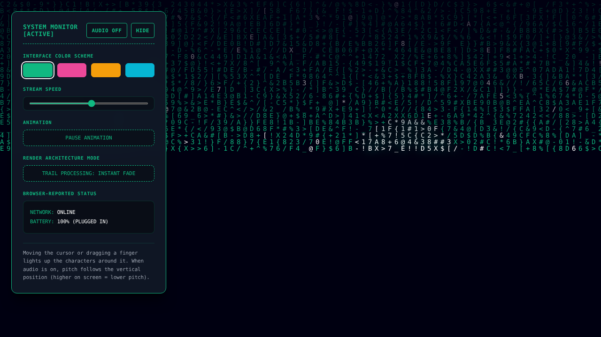
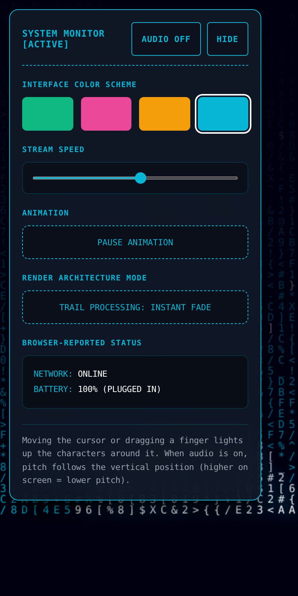

# Interactive Visual Effect

A Matrix-style "digital rain" built with plain HTML5 Canvas and vanilla JavaScript: no frameworks, no build step. Move your mouse (or drag a finger) and the characters around it light up; optionally, a soft tone follows your pointer. A small control panel changes colour, speed and trail length.

| Desktop | Mobile |
|---|---|
|  |  |

*(The white, glowing glyphs are the spotlight around the pointer / finger. Screenshots are taken from the running app.)*

## Run it

No installation is needed.

**Option 1: open the file.** Double-click `index.html`. Everything works except that the Battery readout may show `UNAVAILABLE` (see [Limitations](#browser-api-limitations)).

**Option 2: a local server (recommended).** From the project folder:

```bash
python3 -m http.server 8000
# then open http://localhost:8000
```

`localhost` counts as a secure context, so every supported API is available. To test on a phone on the same Wi-Fi, open `http://<your-computer-ip>:8000`; note that over plain `http://` on a LAN address, browsers hide secure-context-only APIs such as the Battery Status API.

Files: `index.html` (markup), `style.css` (styles), `script.js` (all behaviour), `docs/` (screenshots).

## How the rendering works

The picture is a grid of character **columns**, each `14px` wide. Every column has one "drop": a number saying which **row** its leading character is on (`rainDrops[column]`).

One animation **step** does this:

1. **Fade the old frame.** Paint a nearly transparent dark rectangle over the whole canvas (`rgba(3, 7, 18, 0.06)`). Old characters are not erased; they just get a little darker each step. That fading *is* the trail. A lower alpha (`0.015`, "Deep Field" mode) fades more slowly, so the trails are longer.
2. **Draw one new character per column** at that column's drop position, chosen at random from `ALPHABET`. It is drawn in the theme colour, or, with a 2% chance, in white (the sparkle).
3. **Advance the drop** by one row. Once a drop has passed the bottom of the screen, each step has a 2.5% chance of sending it back to the top. This random reset is what makes the columns drift out of sync and look organic.

**Timing.** The speed slider (5 to 100) sets a step interval of `110 - speed` milliseconds. The loop runs on `requestAnimationFrame`, so drawing is synchronised with the display and stops automatically in background tabs; a step runs only when enough time has elapsed. Because the browser can't paint faster than the display refreshes, very high speeds are capped at the refresh rate (typically 60 steps per second).

**Resizing.** On every resize the canvas is resized (which clears it), the number of columns is recalculated, existing drops are kept, and new columns (if the window got wider) start at random rows so no seam shows. Resize events are coalesced to one update per animation frame.

## How the pointer affects the animation

Mouse and touch both feed one shared pointer position.

- Every step, each column's current character position is compared with the pointer. Columns within **140px** get a **white character with a glow** (`shadowBlur`) instead of the theme colour.
- Distances are compared **squared** (`dx² + dy² < r²`), which avoids a square root per column per step, and columns too far away horizontally are rejected before the vertical distance is computed.
- At high speed (above 75) a few characters near the pointer randomly skip a step, which makes the spotlight look like it glitches.
- **Touch:** `touchstart` / `touchmove` read `event.touches[0]`, the first finger on the screen. Lifting the last finger removes the spotlight. Touches that start on the control panel (for example dragging the slider) are ignored by the effect. The canvas uses `touch-action: none` so the browser does not turn finger drags into page scrolling.
- Leaving the browser window removes the spotlight.

## Audio and frequency mapping

Audio is **off by default** and starts only when you press **AUDIO OFF → AUDIO ON** (browsers require a user gesture before audio may start).

A single sine-wave oscillator runs through a gain (volume) node. It is created once, on the first press, and then reused:

```
frequency (Hz) = 150 + (pointerY / viewportHeight) × 200      →  150 Hz … 350 Hz
```

- Pointer at the **top** of the screen → **150 Hz** (lower pitch). At the **bottom** → **350 Hz** (higher pitch).
- The mapping is **linear in Hz**, covering a bit more than an octave. Pitch perception is logarithmic, so equal vertical distances do not sound like equal musical intervals.
- The volume rises quickly while the pointer moves and fades to silence about 0.1 s after it stops. All changes use `setTargetAtTime`, which glides smoothly and avoids clicks.
- Audio updates are limited to one per 30 ms, however fast the pointer events arrive.
- Pressing **AUDIO ON → OFF** fades the tone out and suspends the audio context so nothing keeps running. The context is also suspended while the tab is hidden.

## Accessibility

- **Reduced motion:** if the OS setting "reduce motion" is on, the page starts paused showing a still picture, and the interface stops animating. The **PLAY ANIMATION / PAUSE ANIMATION** button lets anyone start or stop the motion at any time.
- All controls are real `<button>` / `<input>` elements, reachable by keyboard, with visible focus outlines. Colour swatches have text names and `aria-pressed`; the speed slider has a `<label>`.
- Hiding the panel removes it from the tab order and moves focus to the "show" button.
- Touch targets are at least 44 px tall on touch screens, and the panel fits phones as narrow as 320 px.
- Status text meets WCAG AA contrast (about 7:1).
- The canvas is decorative (`aria-hidden`). The pointer effect is mouse/touch only; it is purely visual and not needed to use the page.

## Browser API limitations

| API | Used for | Limitation / fallback |
|---|---|---|
| Canvas 2D | all drawing | Universal. If unavailable, a message is shown instead of a blank page. |
| Web Audio API | the tone | Needs a user gesture to start (hence the button). If missing or blocked, the button shows `AUDIO N/A` / stays off. On iOS the hardware silent switch can mute Web Audio. |
| Touch Events | finger tracking | Not present on desktop-only browsers (harmless). Multi-touch: only the first finger drives the spotlight. |
| `navigator.onLine` | NETWORK readout | `ONLINE` means only that the browser *thinks* it has a network connection. It does not prove internet access, and says nothing about security. `OFFLINE` is reliable. |
| Battery Status API | BATTERY readout | Chromium-based browsers only (Chrome, Edge, Opera, Android); not in Firefox or Safari. Requires HTTPS or `localhost`. Shows `UNAVAILABLE` otherwise. |
| `matchMedia` | reduced-motion setting | If missing, the animation simply starts as normal. |
| Google Fonts | UI font | Optional. Offline or blocked, the UI falls back to the system monospace font. The rain itself always uses the system monospace font. |

The status panel only shows what the browser reports; nothing in it is simulated.

## Project structure

```
index.html   markup and panel
style.css    styles; the theme colour is one CSS variable (--theme)
script.js    rain, pointer input, audio, controls, status readouts
docs/        screenshots
```
